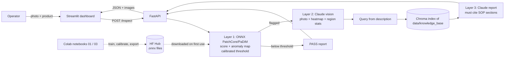

# Architecture

## Request lifecycle (`POST /inspect`)

1. `imaging.load_image` decodes the full-size upload; a ≤1024 px copy is made for overlays and the VLM.
2. `detector.get_detector(product)` returns a cached ONNX session for `{model}_{category}.onnx` with the threshold from its calibration file, or the demo heuristic if no model is found. The image goes in as raw 0..1 RGB, duplicated if the export has a fixed batch of 2.
3. `imaging.defect_region_stats` turns the anomaly map into a bounding box, area share and a location word.
4. If flagged: `copilot.describe_defect` sends original + overlay + numbers to Claude, expects JSON.
5. `rag.retrieve` searches SOP chunks with a query built from the description, boosting the product's own SOP.
6. If flagged: `copilot.write_report` asks Claude for verdict, severity, disposition, actions and citations, using only the retrieved excerpts. Otherwise a rule-based PASS.
7. Result stored in in-memory history; Markdown report at `/history/{id}/report.md`.

## Design rules

- Each layer can fail without breaking the next; every result says which backend produced it (`backend`, `generated_by`).
- The LLM never decides alone: it sees detector numbers and must cite SOPs or escalate.
- Configuration only through environment variables (`qc_copilot/config.py`), so local, CI and Space differ only in env.

## Where to extend

| Want to… | Change |
|----------|--------|
| Add a product line | Add it to `SUPPORTED_PRODUCTS` and `PRODUCT_CATEGORY`, export `{model}_{category}.onnx` + calibration, add an SOP file |
| Swap detector (EfficientAD, etc.) | Export to ONNX with the same output names; set `MODEL_BOTTLE` / `MODEL_PCB` |
| Persist results | Replace `HISTORY` in `api.py` with a database write |
| Faster CPU inference | Notebooks already export OpenVINO; add an OpenVINO class beside `OnnxDetector` |
